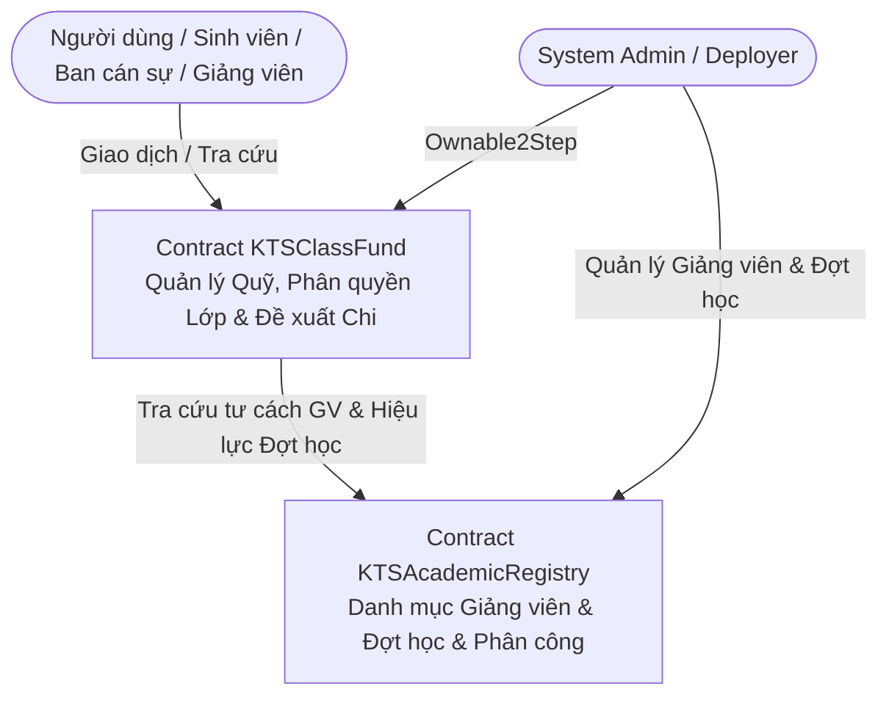

# TÀI LIỆU THIẾT KẾ KIẾN TRÚC SMART CONTRACT — KTS CLASS FUND

> **Dự án:** KTS Class Fund (Học phần ECO2432)  
> **Ngôn ngữ & Phiên bản:** Solidity `^0.8.20`  
> **Thư viện tiêu chuẩn:** OpenZeppelin Contracts `5.x` (`Ownable2Step`, `ReentrancyGuard`)  
> **Căn cứ đặc tả:** [docs/SPEC.md](file:///d:/document/TDT/KTS-Class-Fund/docs/SPEC.md) & [AGENTS.md](file:///d:/document/TDT/KTS-Class-Fund/AGENTS.md)  
> **Quyết định nhóm QA-04:** **Phương án A (Kiểm tra kép)** — Cử tri phải thuộc danh sách snapshot lúc tạo đề xuất VÀ đang là Class Officer hợp lệ tại thời điểm gọi giao dịch `voteProposal`.

---

## 1. Kiến trúc tổng thể và Trách nhiệm Contract

Hệ thống được thiết kế theo mô hình **Modular Architecture tách bạch trách nhiệm**, bảo đảm tính cô lập dữ liệu theo từng lớp học (`classId`), tuân thủ giới hạn gas và kích thước bytecode (EIP-170):



### 1.1. Phân chia Contract
1. **`KTSAcademicRegistry.sol` (Hợp đồng Quản trị Đào tạo & Giảng viên):**
   - **Trách nhiệm:**
     - Quản lý danh mục Giảng viên độc lập (`lecturerId`, `lecturerAddress`, `isActive`).
     - Quản lý cấu trúc năm học và vòng đời đợt học 3 tháng theo lịch (`phaseId`, `startTime`, `endTime`, `status`, `closedAt`).
     - Quản lý phân công giảng dạy theo lô (`batchId`, `phaseId`, `classId`, `lecturerId`, `isValid`).
     - Độc quyền bởi `SystemAdmin` (kế thừa `Ownable2Step`).
     - Cung cấp các hàm `view` kiểm tra tư cách giảng viên đang hoạt động, hiệu lực đợt học và phân công giảng dạy cho contract Quỹ.

2. **`KTSClassFund.sol` (Hợp đồng Quản lý Quỹ lớp & Vòng đời Đề xuất Chi):**
   - **Trách nhiệm:**
     - Quản trị Cố vấn học tập (Advisor) và Ban cán sự (Class Officer) theo từng `classId`.
     - Nhận và quản lý số dư quỹ cô lập theo từng `classId` (`depositToClass`).
     - Khởi tạo đề xuất chi (`createProposal`) với điều kiện bắt buộc `eligibleVoterCount >= 1`.
     - Quản lý biểu quyết tập thể theo snapshot cử tri kết hợp kiểm tra kép (Phương án A) và tính ngưỡng $\lceil 0.51 \times N \rceil$ (`voteProposal`).
     - Quản lý giải ngân an toàn bằng `call{value: ...}("")` với `ReentrancyGuard` và Checks-Effects-Interactions (`executeProposal`).
     - Cơ chế hủy khẩn cấp đề xuất của giảng viên bị đình chỉ (`cancelSuspendedLecturerProposal`).
     - Cơ chế chuyển trạng thái lười công khai (`failProposal`, `expireProposal`) và tính toán trạng thái hiệu lực tức thời (`getProposalState`).

### 1.2. Quy trình Triển khai, Khởi tạo & Quyền sở hữu (Deployment & Initialization)
Cả hai contract đều kế thừa `Ownable2Step` của OpenZeppelin Contracts 5.x (`constructor(address initialOwner) Ownable(initialOwner)`):
1. **Bước 1: Triển khai `KTSAcademicRegistry.sol`**
   - Constructor: `constructor(address initialAdmin) Ownable(initialAdmin)`
   - Ràng buộc: `initialAdmin != address(0)`.
   - Kết quả: `initialAdmin` trở thành System Admin đầu tiên sở hữu registry.
2. **Bước 2: Triển khai `KTSClassFund.sol`**
   - Constructor: `constructor(address initialAdmin, address registryAddress) Ownable(initialAdmin)`
   - Ràng buộc: `initialAdmin != address(0)`, `registryAddress != address(0)`.
   - Gán `registry = IKTSAcademicRegistry(registryAddress)` (biến `immutable` tối ưu gas).
3. **Bước 3: Chuyển giao quyền sở hữu quản trị (nếu có):**
   - Nếu deployer là ví tạm thời/script, deployer gọi `transferOwnership(adminOfficial)`.
   - `adminOfficial` chủ động gọi `acceptOwnership()` trên cả hai contract để hoàn tất.
4. **Nguyên tắc phân quyền tối thiểu (Least Privilege):**
   - System Admin chỉ có quyền quản trị danh mục (giảng viên, đợt học, phân công, khởi tạo lớp).
   - System Admin **không** có quyền rút tiền quỹ lớp, **không** tự ý thêm/xóa Ban cán sự (thuộc quyền Advisor của lớp), và **không** có quyền bỏ phiếu cho đề xuất chi.

---

## 2. Mô hình Dữ liệu: Enums, Structs, Mappings & Relationships

### 2.1. Định nghĩa Enums
```solidity
enum PhaseStatus {
    OPEN,       // 0: Đợt học đang mở
    CLOSED      // 1: Đợt học đã đóng bởi System Admin sau endTime
}

enum ProposalState {
    Pending,    // 0: Đang nhận phiếu (thời hạn 7 ngày)
    Ready,      // 1: Đạt ngưỡng >= 51%, sẵn sàng giải ngân
    Executed,   // 2: Đã chuyển ETH thành công (Trạng thái kết thúc)
    Failed,     // 3: Quá 7 ngày chưa đạt ngưỡng (Trạng thái kết thúc)
    Cancelled,  // 4: Bị hủy do GV bị đình chỉ (Trạng thái kết thúc)
    Expired     // 5: Đã Ready nhưng quá hạn 5 ngày sau khi đợt học CLOSED (Trạng thái kết thúc)
}

enum ProposerRole {
    ClassOfficer,   // 0: Ban cán sự tạo đề xuất
    Advisor,        // 1: Cố vấn học tập tạo đề xuất
    Lecturer        // 2: Giảng viên có phân công giảng dạy tạo đề xuất
}
```

### 2.2. Định nghĩa Structs
```solidity
// Dữ liệu Giảng viên trong KTSAcademicRegistry
struct Lecturer {
    string lecturerId;      // Mã định danh giảng viên ổn định (ví dụ: "GV001")
    address lecturerAddress;// Địa chỉ ví Ethereum hiện hành
    bool isActive;          // Trạng thái hoạt động (true: bình thường, false: đình chỉ/ngừng hoạt động)
    bool exists;            // Đánh dấu bản ghi đã khởi tạo
}

// Dữ liệu Đợt học trong KTSAcademicRegistry
struct Phase {
    string phaseId;         // Mã đợt học chuẩn hóa (ví dụ: "2026-S1-P1")
    uint256 startTime;      // Timestamp bắt đầu (00:00:00 ngày đầu tiên)
    uint256 endTime;        // Timestamp kết thúc (23:59:59 ngày cuối cùng của 3 tháng theo lịch)
    PhaseStatus status;     // OPEN hoặc CLOSED
    uint256 closedAt;       // Timestamp thực tế khi System Admin gọi closePhase
    bool exists;            // Đánh dấu đợt học tồn tại
}

// Dữ liệu Phân công giảng dạy
struct TeachingAssignment {
    string phaseId;
    uint256 classId;
    string lecturerId;
    address lecturerAddress;
    string courseCode;
    bool isValid;           // Hiệu lực phân công
    bool exists;
}

// Dữ liệu Đề xuất chi trong KTSClassFund
struct Proposal {
    uint256 proposalId;         // Định danh đề xuất duy nhất trong lớp
    uint256 classId;            // Mã lớp sở hữu đề xuất
    address proposer;           // Địa chỉ ví người tạo
    ProposerRole proposerRole;  // Tư cách người tạo (ClassOfficer, Advisor, Lecturer)
    string phaseId;             // Mã đợt học căn cứ (nếu ProposerRole == Lecturer)
    string description;         // Mục đích chi
    uint256 amount;             // Số tiền yêu cầu chi (Wei)
    address payable recipient;  // Địa chỉ người nhận ETH
    uint256 creationTime;       // Timestamp lúc tạo
    uint256 votingDeadline;     // creationTime + 7 days
    
    // Dữ liệu Biểu quyết & Snapshot
    uint256 eligibleVoterCount; // Số lượng Class Officer chốt lúc tạo (bắt buộc >= 1)
    uint256 minimumApprovals;   // Ngưỡng tối thiểu = max(1, ceil(0.51 * eligibleVoterCount))
    uint256 approvalsCount;     // Số phiếu chấp thuận hợp lệ hiện tại
    
    // Trạng thái lưu trữ
    ProposalState state;        // Trạng thái lưu trữ trên blockchain
    
    // Dữ liệu Kiểm toán khi Hủy
    address cancelledBy;        // Người thực hiện hủy (Admin hoặc Advisor)
    uint256 cancelledAt;        // Thời điểm hủy
    bytes32 cancelReason;       // Lý do hủy ("LecturerSuspended")
}
```

### 2.3. Mappings & Quan hệ Dữ liệu (Storage Layout)

#### Trong `KTSAcademicRegistry`:
```solidity
// Tra cứu Giảng viên
mapping(string => Lecturer) public lecturersById; // lecturerId => Lecturer
mapping(address => string) public lecturerIdByAddress; // lecturerAddress => lecturerId

// Tra cứu Đợt học
mapping(string => Phase) public phases; // phaseId => Phase
string[] public phaseList;

// Tra cứu Phân công hiện hành:
// Khóa tra cứu chuẩn hóa dùng abi.encode (tránh xung đột hash do dynamic string packing):
// bytes32 assignmentKey = keccak256(abi.encode(phaseId, classId, lecturerId));
mapping(bytes32 => TeachingAssignment) public assignments;

// Cơ chế bảo toàn lịch sử phân công theo R0-B:
// - Smart contract lưu trạng thái hiệu lực hiện hành (`isValid == true/false`) trong storage.
// - Hạn chế của sự kiện lô: Nếu chỉ phát sự kiện tổng `TeachingAssignmentsBatchUpdated(batchId, phaseId, recordCount)`,
//   hệ thống off-chain (The Graph / Event Indexer) KHÔNG ĐỦ dữ liệu để tái dựng lịch sử từng phân công (ai được gán vào lớp nào, môn gì).
// - Do đó, trong vòng lặp batch, hợp đồng bắt buộc phát thêm sự kiện chi tiết cho từng bản ghi:
//   event TeachingAssignmentRecordUpdated(bytes32 indexed batchId, string indexed phaseId, uint256 indexed classId, string lecturerId, address lecturerAddress, string courseCode, bool isValid, uint256 timestamp);
// - Khi một phân công bị thu hồi (`isValid = false`), bản ghi không bị xóa khỏi storage mà chỉ đánh dấu mất hiệu lực, đồng thời phát event chi tiết với `isValid = false`. Nhờ vậy, toàn bộ chuỗi lịch sử phân công/thu hồi có thể được tái dựng hoàn chỉnh 100% ngoài chuỗi.
```

#### Trong `KTSClassFund`:
```solidity
IKTSAcademicRegistry public immutable registry;

// 1. Quản lý Quỹ cô lập theo lớp:
mapping(uint256 => uint256) public classBalances; // classId => Số dư ETH (Wei)
mapping(uint256 => bool) public classExists;       // classId => Đã khởi tạo

// 2. Quản lý Vai trò theo lớp:
mapping(uint256 => address) public classAdvisors;  // classId => Địa chỉ Advisor
// Quản lý danh sách Class Officer bằng EnumerableSet của OpenZeppelin:
// - Đảm bảo O(1) thêm, xóa (swap-and-pop an toàn)
// - Tuyệt đối không chứa phần tử trùng lặp
// - Không để sót phần tử đã bị xóa trong danh sách hiện hành
// - length() trả về chính xác 100% số lượng cán sự hợp lệ hiện hành
mapping(uint256 => EnumerableSet.AddressSet) private _classOfficers;

// 3. Quản lý Đề xuất chi:
mapping(uint256 => uint256) public proposalCount; // classId => tổng số proposal
mapping(uint256 => mapping(uint256 => Proposal)) public proposals; // classId => proposalId => Proposal

// 4. Quản lý Snapshot Cử tri & Lá phiếu cho từng Đề xuất:
// classId => proposalId => voterAddress => đã bỏ phiếu hay chưa
mapping(uint256 => mapping(uint256 => mapping(address => bool))) public hasVoted;

// Snapshot cử tri đủ điều kiện tại thời điểm tạo đề xuất:
// classId => proposalId => voterAddress => nằm trong snapshot hay không
// Được lập bằng cách duyệt chính xác tập hợp _classOfficers[classId].values() duy nhất tại thời điểm tạo
mapping(uint256 => mapping(uint256 => mapping(address => bool))) public isSnapshotVoter;
```

---

## 3. Đặc tả Functions, Interfaces, Access Control & Events

### 3.1. Danh mục Custom Errors (Tối ưu Gas theo AGENTS.md)
```solidity
error Unauthorized();
error InvalidClassId();
error InvalidAddress();
error InvalidAmount();
error EmptyDescription();
error EmptyPhaseId();
error TimeRangeInvalid();
error PhaseAlreadyExists();
error PhaseNotEnded();
error PhaseAlreadyClosed();
error PhaseNotClosed();
error LecturerInactive();
error AssignmentNotFound();
error NoEligibleVoters();
error ProposalNotFound();
error ProposalNotPending();
error ProposalNotReady();
error ProposalNotCancellable();
error ProposalAlreadyVoted();
error VotingDeadlineExceeded();
error VotingDeadlineNotPassed();
error ExecutionDeadlineExceeded();
error ExecutionDeadlineNotPassed();
error InsufficientBalance();
error PaymentFailed();
error CannotCancelStudentProposal();
error LecturerNotSuspended();
```

### 3.2. Danh mục Events on-chain đầy đủ
```solidity
// Sự kiện Đào tạo
event LecturerRegistered(string indexed lecturerId, address indexed lecturerAddress, uint256 timestamp);
event LecturerStatusUpdated(string indexed lecturerId, address indexed lecturerAddress, bool isActive, uint256 timestamp);
event PhaseCreated(string indexed phaseId, uint256 startTime, uint256 endTime, uint256 timestamp);
event PhaseClosed(string indexed phaseId, uint256 closedAt, address indexed admin);
event TeachingAssignmentsBatchUpdated(bytes32 indexed batchId, string indexed phaseId, uint256 recordCount, uint256 timestamp);
event TeachingAssignmentRecordUpdated(bytes32 indexed batchId, string indexed phaseId, uint256 indexed classId, string lecturerId, address lecturerAddress, string courseCode, bool isValid, uint256 timestamp);

// Sự kiện Quản trị Lớp & Ban cán sự
event ClassInitialized(uint256 indexed classId, uint256 timestamp);
event AdvisorAssigned(uint256 indexed classId, address indexed advisor, uint256 timestamp);
event ClassOfficerAdded(uint256 indexed classId, address indexed officer, uint256 timestamp);
event ClassOfficerRemoved(uint256 indexed classId, address indexed officer, uint256 timestamp);

// Sự kiện Tài chính & Đề xuất chi
event DepositReceived(uint256 indexed classId, address indexed sender, uint256 amount, uint256 timestamp);
event ProposalCreated(
    uint256 indexed classId,
    uint256 indexed proposalId,
    address indexed proposer,
    uint256 amount,
    address recipient,
    uint256 eligibleVoterCount,
    uint256 minimumApprovals,
    uint256 votingDeadline
);
event VoteCast(uint256 indexed classId, uint256 indexed proposalId, address indexed voter, uint256 currentApprovals);
event ProposalReady(uint256 indexed classId, uint256 indexed proposalId, uint256 approvalsCount);
event ProposalExecuted(uint256 indexed classId, uint256 indexed proposalId, address indexed executor, address recipient, uint256 amount, uint256 timestamp);
event ProposalFailed(uint256 indexed classId, uint256 indexed proposalId, address indexed caller, uint256 timestamp);
event ProposalCancelled(uint256 indexed classId, uint256 indexed proposalId, address indexed caller, address lecturer, bytes32 reason, uint256 timestamp);
event ProposalExpired(uint256 indexed classId, uint256 indexed proposalId, address indexed caller, uint256 timestamp);
```

### 3.3. Các hàm trong `KTSAcademicRegistry`
1. `registerLecturer(string calldata lecturerId, address lecturerAddress)`
   - **Quyền:** System Admin (`onlyOwner`).
   - **Điều kiện & Ràng buộc toàn vẹn 2 chiều:**
     - `bytes(lecturerId).length > 0`, `lecturerAddress != address(0)`, `lecturerAddress != address(this)`.
     - `!lecturersById[lecturerId].exists` (mã giảng viên duy nhất tuyệt đối).
     - `bytes(lecturerIdByAddress[lecturerAddress]).length == 0` (địa chỉ ví chưa từng được gán cho giảng viên nào khác).
   - **Hiệu ứng:** Lưu bản ghi `Lecturer(lecturerId, lecturerAddress, true, true)`, mapping 2 chiều đồng bộ, phát `LecturerRegistered`.

2. `updateLecturerAddress(string calldata lecturerId, address newLecturerAddress)`
   - **Quyền:** System Admin (`onlyOwner`).
   - **Điều kiện:**
     - `lecturersById[lecturerId].exists == true`.
     - `newLecturerAddress != address(0)`, `newLecturerAddress != address(this)`.
     - Trường hợp đổi thành chính địa chỉ hiện tại (`newLecturerAddress == oldAddress`): Không thao tác gì hoặc revert `SameAddress()`.
     - Trường hợp đổi sang địa chỉ mới (`newLecturerAddress != oldAddress`): Bắt buộc kiểm tra `bytes(lecturerIdByAddress[newLecturerAddress]).length == 0` (địa chỉ ví mới chưa thuộc về giảng viên nào khác).
   - **Hiệu ứng & Bảo toàn dữ liệu lịch sử:**
     - Xóa mapping cũ: `delete lecturerIdByAddress[oldAddress]`.
     - Cập nhật địa chỉ hiện hành: `lecturersById[lecturerId].lecturerAddress = newLecturerAddress`.
     - Gán mapping mới: `lecturerIdByAddress[newLecturerAddress] = lecturerId`.
     - *Cơ chế tra cứu phân công và đề xuất khi đổi ví:*
       - Khóa phân công giảng dạy `keccak256(abi.encode(phaseId, classId, lecturerId))` sử dụng `lecturerId` ổn định.
       - Khi kiểm tra quyền tạo đề xuất của giảng viên (`isValidAssignment`), hợp đồng tra cứu `lecturerId = lecturerIdByAddress[msg.sender]` và sau đó kiểm tra bản ghi phân công theo `lecturerId`. Nhờ đó, giảng viên sử dụng ví mới vẫn tự động nhận diện đúng phân công giảng dạy mà không cần cập nhật lại từng bản ghi phân công trong quá khứ!
       - Các đề xuất đã tạo trong quá khứ lưu địa chỉ ví tại thời điểm tạo không bị sửa đổi, bảo toàn 100% tính xác thực lịch sử.

3. `setLecturerStatus(string calldata lecturerId, bool isActive)`
   - **Quyền:** System Admin (`onlyOwner`).
   - **Điều kiện:** Tồn tại `lecturersById[lecturerId].exists == true`.
   - **Hiệu ứng:** Cập nhật `lecturersById[lecturerId].isActive = isActive`, phát `LecturerStatusUpdated`.

4. `createPhase(string calldata phaseId, uint256 startTime, uint256 endTime)`
   - **Quyền:** System Admin (`onlyOwner`).
   - **Điều kiện:** `startTime < endTime`, `phaseId` không rỗng, chưa tồn tại.

5. `closePhase(string calldata phaseId)`
   - **Quyền:** System Admin (`onlyOwner`).
   - **Điều kiện:** `block.timestamp > phase.endTime` (tại `block.timestamp == endTime` bị revert). Trạng thái `phase.status == OPEN`.
   - **Hành động:** `phase.status = CLOSED`, `phase.closedAt = block.timestamp`, phát `PhaseClosed`.

6. `batchUpsertAssignments(bytes32 batchId, string calldata phaseId, AssignmentInput[] calldata records)`
   - **Quyền:** System Admin (`onlyOwner`).
   - **Hành động:** Lưu bản ghi phân công, phát sự kiện tổng `TeachingAssignmentsBatchUpdated`.

7. `isLecturerActive(address addr) external view returns (bool)`
8. `isValidAssignment(string calldata phaseId, uint256 classId, address lecturerAddr) external view returns (bool)`
9. `getPhase(string calldata phaseId) external view returns (Phase memory)`

### 3.4. Các hàm trong `KTSClassFund`
1. `initializeClass(uint256 classId, address advisor)`
   - **Quyền:** System Admin (`onlyOwner`).
   - **Điều kiện:** `classId > 0`, `!classExists[classId]`, `advisor != address(0)`, `advisor != address(this)`, `registry.isLecturerActive(advisor) == true`.
   - **Hiệu ứng:** `classExists[classId] = true`, `classAdvisors[classId] = advisor`, phát `ClassInitialized`, `AdvisorAssigned`.

2. `addOfficer(uint256 classId, address officer)` / `removeOfficer(uint256 classId, address officer)`
   - **Quyền:** Advisor của lớp (`classAdvisors[classId] == msg.sender`).
   - **Điều kiện:** `classExists[classId] == true`, `officer != address(0)`, `officer != advisor`, `officer != address(this)`.
   - **Cơ chế an toàn (Dùng EnumerableSet):**
     - Khi thêm: Kiểm tra `!_classOfficers[classId].contains(officer)` (tránh thêm trùng). Gọi `_classOfficers[classId].add(officer)`. Phát `ClassOfficerAdded`.
     - Khi xóa: Kiểm tra `_classOfficers[classId].contains(officer)`. Gọi `_classOfficers[classId].remove(officer)` (tự động swap-and-pop an toàn, không để sót địa chỉ đã xóa). Phát `ClassOfficerRemoved`.

3. `depositToClass(uint256 classId) external payable`
   - **Quyền:** Bất kỳ ai.
   - **Điều kiện:** `classExists[classId] == true` (ngăn chặn nạp tiền vào lớp chưa khởi tạo), `msg.value > 0`.
   - **Hiệu ứng:** `classBalances[classId] += msg.value`, phát `DepositReceived`.

4. `createProposal(uint256 classId, uint256 amount, address payable recipient, string calldata description, string calldata phaseId)`
   - **Quyền & Quy tắc ưu tiên xác định vai trò (`proposerRole`):**
     - Khi một địa chỉ có nhiều vai trò (ví dụ: vừa là Giảng viên vừa là Advisor của lớp):
       1. Nếu là Cố vấn học tập (`classAdvisors[classId] == msg.sender`): Gán `proposerRole = ProposerRole.Advisor`. Không bắt buộc truyền `phaseId`. Đề xuất không bị hủy bởi cơ chế đình chỉ giảng viên.
       2. Nếu là Ban cán sự (`_classOfficers[classId].contains(msg.sender) == true`): Gán `proposerRole = ProposerRole.ClassOfficer`. Không bắt buộc truyền `phaseId`. Không bị hủy bởi cơ chế đình chỉ giảng viên.
       3. Nếu là Giảng viên có phân công giảng dạy (`registry.isValidAssignment(phaseId, classId, msg.sender) == true`): Bắt buộc `bytes(phaseId).length > 0`, đợt học `phaseId` phải đang `OPEN` và `block.timestamp <= endTime`. Gán `proposerRole = ProposerRole.Lecturer`. Đề xuất này chịu sự quản lý của cơ chế hủy khẩn cấp nếu giảng viên bị đình chỉ (`cancelSuspendedLecturerProposal`).
     - Người gọi không thỏa mãn vai trò nào ở trên: Revert `Unauthorized()`.
   - **Ràng buộc dữ liệu:** `classExists[classId] == true`, `amount > 0`, `recipient != address(0)`, `recipient != address(this)`, `bytes(description).length > 0`.
   - **Ràng buộc cử tri:** Lấy `eligibleVoterCount = _classOfficers[classId].length()`. Yêu cầu bắt buộc: `eligibleVoterCount >= 1` (nếu bằng 0 revert `NoEligibleVoters()`).
   - **Snapshot cử tri:** Duyệt chính xác các phần tử duy nhất trong `_classOfficers[classId].values()` tại thời điểm tạo và gán `isSnapshotVoter[classId][proposalId][officer] = true`.
   - **Ngưỡng:** `minimumApprovals = Math.max(1, (51 * eligibleVoterCount + 99) / 100)`.

5. `voteProposal(uint256 classId, uint256 proposalId)`
   - **Quyền:** Cử tri thỏa mãn **Phương án A (Kiểm tra kép)**:
     - Ràng buộc 1: `isSnapshotVoter[classId][proposalId][msg.sender] == true` (thuộc snapshot chốt tại thời điểm tạo).
     - Ràng buộc 2: `_classOfficers[classId].contains(msg.sender) == true` (hiện tại vẫn đang là Class Officer hợp lệ của lớp).
   - **Điều kiện:** Đề xuất ở `Pending`, `!hasVoted[classId][proposalId][msg.sender]`, `block.timestamp <= proposal.votingDeadline`.
   - **Chuyển trạng thái:** Nếu `approvalsCount + 1 >= minimumApprovals`, chuyển `proposal.state = Ready`, phát `ProposalReady`.

6. `executeProposal(uint256 classId, uint256 proposalId) nonReentrant`
   - **Quyền:** Class Officer đương nhiệm của lớp (`_classOfficers[classId].contains(msg.sender) == true`).
   - **Điều kiện:** `proposal.state == Ready`.
   - **Kiểm tra thời hạn:**
     - Nếu đề xuất có liên kết `phaseId` hợp lệ (`bytes(proposal.phaseId).length > 0`):
       - Nếu đợt học căn cứ đang mở (`phase.status == OPEN`): Không áp dụng hạn 5 ngày; giải ngân bình thường.
       - Nếu đợt học căn cứ đã `CLOSED`:
         - Nếu `block.timestamp <= phase.closedAt + 5 days`: Cho phép giải ngân bình thường (kể cả tại mốc biên `==`).
         - Nếu `block.timestamp > phase.closedAt + 5 days`: Lazy Transition -> Gán `proposal.state = Expired`, phát `ProposalExpired`, kết thúc giao dịch thành công (không chuyển ETH, không revert).
     - Nếu đề xuất không gắn với `phaseId` (đề xuất do Class Officer hoặc Advisor tạo ra):
       - Tiếp tục giải ngân bình thường (không chịu ràng buộc hạn 5 ngày của đợt học).
   - **Chuyển ETH & An toàn giao dịch:**
     - Kiểm tra `classBalances[classId] >= proposal.amount`.
     - Effects trước: `proposal.state = Executed`, `classBalances[classId] -= proposal.amount`.
     - Interactions: `(bool success, ) = proposal.recipient.call{value: proposal.amount}("")`.
     - Nếu `!success`: Revert `PaymentFailed()`. Giao dịch revert đưa toàn bộ storage về lại trạng thái `Ready` và số dư quỹ giữ nguyên vẹn.

7. `cancelSuspendedLecturerProposal(uint256 classId, uint256 proposalId)`
   - **Quyền:** System Admin (mọi lớp) HOẶC Advisor của lớp (`classAdvisors[classId] == msg.sender`).
   - **Điều kiện kiểm tra trạng thái hiệu lực (Chống xung đột Lazy State):**
     - `proposal.proposerRole == ProposerRole.Lecturer` (tuyệt đối không áp dụng cho Class Officer/Advisor).
     - Giảng viên tạo đề xuất hiện đang bị đình chỉ: `!registry.isLecturerActive(proposal.proposer)`.
     - **Kiểm tra trạng thái hiệu lực thời gian thực:**
       - Nếu đề xuất ở storage là `Pending` nhưng đã quá hạn 7 ngày (`block.timestamp > proposal.votingDeadline`): Đề xuất đã có trạng thái hiệu lực là `Failed`. Hợp đồng **từ chối hủy** (revert `ProposalNotCancellable()`), hoặc tự động chuyển storage sang `Failed`.
       - Nếu đề xuất ở storage là `Ready` nhưng có `phaseId`, đợt học đã `CLOSED` và quá hạn 5 ngày (`phase.status == CLOSED && block.timestamp > phase.closedAt + 5 days`): Đề xuất đã có trạng thái hiệu lực là `Expired`. Hợp đồng **từ chối hủy** (revert `ProposalNotCancellable()`), hoặc tự động chuyển storage sang `Expired`.
       - Đề xuất đang ở trạng thái kết thúc trong storage (`Executed`, `Failed`, `Cancelled`, `Expired`): Revert `ProposalNotCancellable()`.
     - Chỉ cho phép hủy khi đề xuất đang thực sự có hiệu lực là `Pending` (trong hạn 7 ngày) hoặc `Ready` (chưa quá hạn 5 ngày giải ngân).
   - **Hiệu ứng:** `proposal.state = Cancelled`, lưu `cancelledBy`, `cancelledAt`, `cancelReason`, phát `ProposalCancelled`.
   - **Bảo toàn quỹ:** Không làm chuyển bất kỳ khoản ETH nào từ quỹ lớp.

8. `failProposal(uint256 classId, uint256 proposalId)`
   - **Quyền:** Bất kỳ ai (công khai).
   - **Điều kiện:** `proposal.state == Pending`, `block.timestamp > proposal.votingDeadline`.
   - **Hiệu ứng:** `proposal.state = Failed`, phát `ProposalFailed`.

9. `expireProposal(uint256 classId, uint256 proposalId)`
   - **Quyền:** Bất kỳ ai (công khai).
   - **Điều kiện:** `proposal.state == Ready`, có gắn `phaseId`, đợt học căn cứ đã đóng `phase.status == CLOSED`, và `block.timestamp > phase.closedAt + 5 days`.
   - **Hiệu ứng:** `proposal.state = Expired`, phát `ProposalExpired`.

10. `getProposalState(uint256 classId, uint256 proposalId) external view returns (ProposalState)`
    - **Logic tính toán trạng thái hiệu lực tức thời (Effective State):**
      - Nếu `state` trong storage là `Executed`, `Failed`, `Cancelled`, `Expired`: Trả về trực tiếp giá trị storage.
      - Nếu `state == Pending`:
        - Nếu `block.timestamp > proposal.votingDeadline` -> Trả về `ProposalState.Failed`.
        - Ngược lại -> Trả về `ProposalState.Pending`.
      - Nếu `state == Ready`:
        - Nếu đề xuất có gắn `phaseId`, đợt học căn cứ đã đóng (`phase.status == CLOSED`) VÀ `block.timestamp > phase.closedAt + 5 days` -> Trả về `ProposalState.Expired`.
        - Ngược lại (bao gồm đợt học còn `OPEN`, chưa quá hạn 5 ngày, hoặc đề xuất không gắn `phaseId`) -> Trả về `ProposalState.Ready`.

---

## 4. Bảng truy vết từ Quy tắc R0–R10 đến Smart Contract Function và Test Cases

| Mã Quy tắc | Nội dung cốt lõi | Smart Contract / Function phụ trách | Test Cases bao phủ |
| :--- | :--- | :--- | :--- |
| **R0-A** | Quản trị System Admin, `Ownable2Step`, Danh mục Giảng viên độc lập | `KTSAcademicRegistry`: `transferOwnership`, `acceptOwnership`, `registerLecturer`, `updateLecturerAddress`, `setLecturerStatus` | TC-11, TC-27, TC-41, TC-42 |
| **R0-B** | Quản lý phân công giảng dạy theo lô, Event tổng & chi tiết, bảo tồn lịch sử | `KTSAcademicRegistry`: `batchUpsertAssignments` | TC-16, TC-43 |
| **R0-C** | Advisor quản lý danh sách Class Officer độc lập theo lớp | `KTSClassFund`: `addOfficer`, `removeOfficer` | TC-01, TC-02, TC-18, TC-44 |
| **R0-D** | Cấu trúc đợt học 3 tháng lịch, `closePhase` sau `endTime`, hạn giải ngân 5 ngày sau đóng | `KTSAcademicRegistry`: `createPhase`, `closePhase`; `KTSClassFund`: `executeProposal`, `expireProposal` | TC-03, TC-10, TC-15, TC-25, TC-26, TC-33, TC-34 |
| **R1** | Nạp tiền vào quỹ lớp độc lập | `KTSClassFund`: `depositToClass` | TC-21 |
| **R2** | Tạo đề xuất chi, kiểm tra căn cứ quyền, yêu cầu bắt buộc `eligibleVoterCount >= 1` | `KTSClassFund`: `createProposal` | TC-03, TC-13, TC-19, TC-20, TC-24, TC-41, TC-43 |
| **R3** | Biểu quyết tập thể 51%, snapshot cử tri, ngưỡng tối thiểu $\ge 1$ (kèm QA-04 Phương án A) | `KTSClassFund`: `voteProposal` | TC-01, TC-04, TC-05, TC-06, TC-18, TC-23, TC-24, TC-28, TC-38, TC-44 |
| **R4** | Ngăn chặn bỏ phiếu trùng lặp | `KTSClassFund`: `voteProposal` (`hasVoted` mapping check) | TC-04 |
| **R5** | Người tạo đề xuất tự bỏ phiếu nếu là Class Officer | `KTSClassFund`: `voteProposal` | TC-14 |
| **R6** | Thực hiện chi tiền giải ngân, bảo vệ ETH, Checks-Effects-Interactions, Lazy Expire | `KTSClassFund`: `executeProposal` | TC-08, TC-10, TC-21, TC-22, TC-26, TC-34, TC-37 |
| **R7** | Chống thực thi hai lần (Đơn nhất giải ngân) | `KTSClassFund`: `executeProposal` (kiểm tra `state == Ready`) | TC-09 |
| **R8** | Xử lý thời hạn 7 ngày, Lazy transition sang `Failed` và `Expired` | `KTSClassFund`: `failProposal`, `expireProposal`, `getProposalState` | TC-05, TC-07, TC-17, TC-23, TC-26, TC-33, TC-38, TC-39 |
| **R9** | Tra cứu minh bạch số dư và lịch sử theo từng `classId` | `KTSClassFund`: `classBalances`, `proposals`, `getProposalState` | TC-21 |
| **R10** | Hủy đề xuất của Giảng viên bị đình chỉ bởi Admin/Advisor | `KTSClassFund`: `cancelSuspendedLecturerProposal` | TC-29, TC-30, TC-31, TC-32, TC-35, TC-36, TC-39, TC-40 |

---

## 5. Rà soát ranh giới thời gian & Tính toàn vẹn của 44 Test Cases

1. **Ranh giới thời hạn biểu quyết 7 ngày (`votingDeadline = creationTime + 7 days`):**
   - Tại `block.timestamp <= creationTime + 7 days` (TC-23): Biểu quyết hợp lệ, được tính phiếu. Hàm `failProposal` bị revert.
   - Tại `block.timestamp > creationTime + 7 days` (TC-05, TC-07, TC-38): Biểu quyết bị revert (`VotingDeadlineExceeded`); hàm `failProposal` thành công chuyển `Pending -> Failed`.
2. **Ranh giới thời hạn giải ngân 5 ngày sau khi đợt học đóng:**
   - Khi đợt học còn `OPEN` (`phase.status == OPEN`, `closedAt == 0` - TC-34): Không áp dụng hạn 5 ngày; giải ngân thành công bất kỳ lúc nào nếu đủ tiền và đúng quyền.
   - Sau khi đợt học chuyển sang `CLOSED`:
     - Tại `block.timestamp <= closedAt + 5 days` (kể cả đúng giây cuối cùng `==` - TC-10, TC-37): Giải ngân thành công.
     - Tại `block.timestamp > closedAt + 5 days` (quá 1 giây trở đi - TC-26, TC-33, TC-40): Lệnh gọi `executeProposal` lần đầu hoặc `expireProposal` chuyển trạng thái sang `Expired`, không chuyển ETH.
3. **Đối chiếu sự thay đổi với Quyết định QA-04 (Phương án A):**
   - Cử tri phải vừa nằm trong snapshot vừa còn quyền Officer lúc gọi vote (`TC-28`).
   - Trường hợp cán sự bị xóa rồi được thêm lại trước deadline (`TC-44`): được phép bỏ phiếu nếu thỏa mãn đồng thời cả 2 điều kiện tại thời điểm vote.

---

## 6. Giả định, Rủi ro Kỹ thuật & Biện pháp kiểm soát

1. **Rủi ro Timestamp Manipulation của Miners/Validators:**
   - Ranh giới thời gian trên Ethereum PoS sử dụng timestamp của block với độ lệch tối đa ~12-15 giây.
   - *Kiểm soát:* Tất cả các mốc thời gian đều có độ dài lớn (7 ngày = 604,800 giây, 5 ngày = 432,000 giây, 3 tháng lịch), do đó độ lệch vài giây không ảnh hưởng tới tính an toàn kinh tế của quỹ.
2. **Rủi ro Reentrancy khi chuyển ETH:**
   - *Kiểm soát:* Áp dụng modifier `nonReentrant` của OpenZeppelin và cập nhật trạng thái `proposal.state = Executed` cùng trừ số dư `classBalances` **trước khi** thực hiện lệnh `call{value: ...}("")`.
4. **Tích hợp Frontend & Trạng thái Giảng viên bị đình chỉ (ARCH-06):**
   - Hàm `getProposalState(classId, proposalId) view` thuần túy tính toán trạng thái hiệu lực theo máy trạng thái on-chain (`Pending`, `Ready`, `Executed`, `Failed`, `Cancelled`, `Expired`).
   - Đề xuất của giảng viên bị đình chỉ (`isActive == false`) vẫn hiển thị `Pending` hoặc `Ready` trên hợp đồng cho đến khi System Admin hoặc Advisor thực hiện giao dịch gọi `cancelSuspendedLecturerProposal`.
   - **Quy tắc tích hợp Frontend:** Giao diện người dùng (Web DApp) khi hiển thị danh sách đề xuất cần truy vấn thêm cờ `registry.isLecturerActive(proposal.proposer)` để gắn nhãn cảnh báo đỏ: `⚠️ Người tạo đã bị đình chỉ - Chờ Admin/Advisor hủy` và kích hoạt nút bấm "Hủy đề xuất khẩn cấp" cho tài khoản có thẩm quyền.

---

## 7. Các câu hỏi nghiệp vụ cần nhóm thống nhất trước khi đóng gói hoàn toàn

1. **Ràng buộc `phaseId` đối với đề xuất của Class Officer và Advisor (ARCH-03):**
   - *Hiện trạng SPEC:* Class Officer và Advisor không bắt buộc truyền `phaseId` khi tạo đề xuất.
   - *Kiến trúc hiện tại:* Đề xuất không gắn `phaseId` chỉ chịu hạn 7 ngày biểu quyết và không bị áp hạn 5 ngày giải ngân sau khi đóng đợt học.
   - *Câu hỏi nhóm:* Nhóm có muốn mọi đề xuất trong lớp đều bắt buộc phải gắn với đợt học đang mở của hệ thống tại thời điểm tạo hay không? Nếu có, `createProposal` sẽ tự động gán `phaseId = registry.currentOpenPhase()` thay vì để rỗng.
2. **Quyền biểu quyết của Cán sự bị xóa rồi được thêm lại (ARCH-04):**
   - *Hiện trạng Phương án A:* Kiểm tra `isSnapshotVoter == true` VÀ `_classOfficers.contains(msg.sender) == true`.
   - *Tình huống:* Nếu Officer X bị xóa rồi được thêm lại trước khi hết 7 ngày, X lại thỏa mãn cả 2 điều kiện và vote được cho đề xuất cũ.
   - *Câu hỏi nhóm:* Nhóm có chấp nhận hành vi này không (vì tại thời điểm vote X đang là cán sự hợp lệ), hay cần tước vĩnh viễn quyền vote cho đề xuất cũ một khi đã từng bị xóa?
3. **Cập nhật TC-28 trong `docs/SPEC.md`:**
   - Cần cập nhật kỳ vọng của TC-28 trong SPEC từ "Vẫn vote thành công cho đề xuất cũ" sang "Bị revert do vi phạm điều kiện cán sự hiện hành" để khớp 100% với Phương án A.
